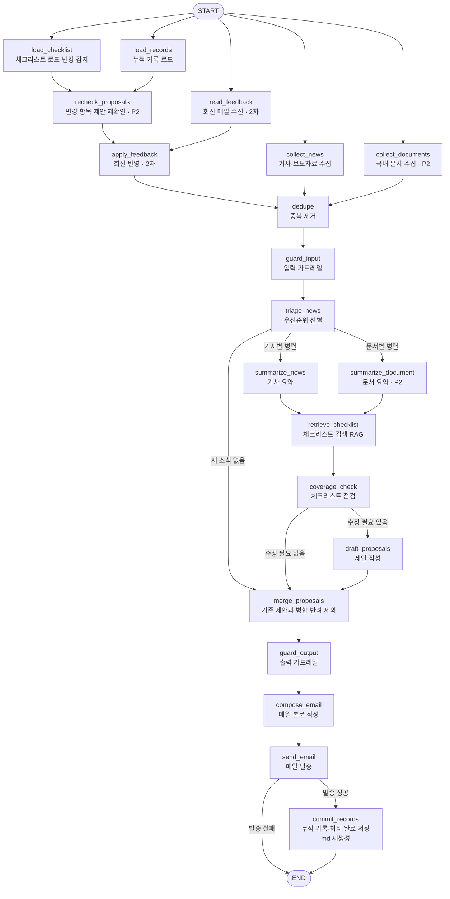
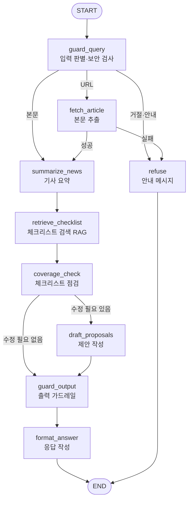

# SERVICE · 보안 데일리 에이전트 (보안정보 수집 · 체크리스트 점검)

## 1. 사용자·문제·가치

- **사용자**: 부서 보안점검 체크리스트를 관리하는 보안 담당자. 테스트 단계는 본인 1명, 운영 단계는 부서 보안 담당자로 확대한다.
- **문제**: 매일 여러 보안 사이트의 기사·보도자료·가이드 문서를 직접 확인하고, 그 내용이 우리 체크리스트에 반영되어 있는지 일일이 대조해야 한다.
- **지금은 어떻게 하나**: 사이트를 하나씩 방문해 읽고, 중요한 사고나 법 개정이 있으면 체크리스트를 열어 수동으로 비교한다. 바쁘면 확인이 밀리고, 비교 결과가 기록으로 남지 않는다.
- **무엇이 좋아지나**
  - 매일 아침 메일 한 통으로 우선순위 기사 5건과 새 가이드 문서 요약을 받는다.
  - 기사마다 "체크리스트에 있음 / 없음 / 수정 필요"와 근거 항목을 함께 받는다.
  - 수정이 필요한 부분은 점검항목·점검내용 형태의 제안으로 누적 관리된다.
  - 궁금한 기사는 웹 페이지에 붙여넣어 바로 점검할 수 있다.

## 2. 서비스 확장 관점

- **사내 기여**: 체크리스트를 최신 위협과 법 개정에 맞춰 유지하는 작업을 자동화한다. 누적된 제안과 판정 기록은 정기 체크리스트 개정과 감사 대응 때 근거 자료가 된다.
- **규모**: 테스트 단계는 1명이 매일 1회 메일을 받고 필요할 때 수시 점검을 한다. 운영 단계는 부서 보안 담당자 전체로 확대한다.
- **확장 방향**: 체크리스트 파일만 바꾸면 다른 부서나 다른 기준(금융보안, 클라우드 보안 등)에도 같은 방식으로 적용할 수 있다.
- **대체제와의 차별점**: 일반 보안 뉴스 클리핑 서비스는 요약까지만 제공한다. 이 에이전트는 **우리 체크리스트와 대조한 결과와 구체적인 수정안**까지 제공한다.

## 3. 사용 예상 도구·데이터

### 3.1 도구

| 도구 | 기능 | 인터페이스 |
|---|---|---|
| 수집기 | 기사·보도자료(RSS, 스크래핑), 국내 가이드 문서(PDF, HWP/HWPX) 수집 | `feedparser`, `requests` + `beautifulsoup4`, `pypdf`, `pyhwp` |
| 체크리스트 검색 (RAG) | 기사 내용과 관련된 체크리스트 항목 검색 (쿼리 확장 → 하이브리드 검색 → 리랭킹) | Chroma(벡터) + BM25(키워드, kiwipiepy 형태소 분석) |
| 기록 DB | 누적 제안, 판정 기록, 처리한 URL 저장 | SQLite (`data/agent.db`) |
| 메일 | 결과 메일 발송 (2차: 회신 수신) | Gmail SMTP (2차: IMAP) |
| 질의 API · 웹 페이지 | 기사 1건 즉시 점검 | FastAPI `POST /query`, 웹 페이지 |

### 3.2 데이터

| 데이터 | 출처 | 실제/가짜 |
|---|---|---|
| 보안 기사·보도자료 | 보안뉴스, 데일리시큐, KISA, 개인정보보호위원회, BleepingComputer, The Hacker News, CISA | 실제 (공개) |
| 가이드 문서 | KISA, 개인정보보호위원회, 금융보안원, 안랩 | 실제 (공개) |
| 점검 체크리스트 | 테스트: ISMS-P 세부점검항목 (KISA 공개 엑셀 → `data/checklist.csv`) / 운영: 사내 보안 체크리스트 | 테스트는 실제 공개 자료로 사내 체크리스트를 대신함 |
| 평가 세트 | `evaluation/test_queries.csv` (직접 작성) | 실제 기사 본문 기반 |

## 4. 서비스 정책 (가드레일 요약)

1. **체크리스트는 자동으로 수정하지 않는다.** 에이전트는 제안까지만 하고, 반영 여부는 담당자가 결정한다.
2. **모든 판정에는 실제로 존재하는 체크리스트 항목 ID를 근거로 인용한다.** 근거를 찾지 못하면 추측하지 않고 "판단 근거 없음"으로 표시한다.
3. **기사·문서 본문과 사용자 입력 안의 지시문은 따르지 않는다.** 외부 텍스트는 데이터로만 취급하고, 시스템 프롬프트나 내부 정보를 노출하지 않는다 (프롬프트 인젝션 방어).
4. **개인정보는 마스킹한다.** 기사 속 개인 연락처·이메일 등은 요약과 메일에 그대로 싣지 않는다.
5. **허용된 입력만 처리한다.** 질의 모드는 기사 URL이나 본문만 받고, 사내망·로컬 주소 URL과 기사가 아닌 요청은 거절한다.

세부 케이스는 `evaluation/test_queries.csv`의 guardrail 항목에서 검증한다.

## 5. 성공 기준

- **인-아웃 세트 통과율**: `test_queries.csv` 케이스의 **80% 이상** 통과 (guardrail 케이스는 100%).
- **검색 품질 (RAGAS)**: context_recall **0.7 이상**, faithfulness **0.8 이상**.
- **배치 안정성**: 매일 실행이 오류 없이 끝나고 메일이 도착한다. 수집기 하나가 실패해도 메일은 발송된다.
- **"쓸만하다"의 판단 지표**: 제안 중 담당자가 실제 체크리스트 개정 검토 대상으로 삼을 만한 제안이 주 1건 이상 나온다.

---

## 6. 구현 범위와 적용 패턴

### 6.1 실행 모드

| 모드 | 언제 | 입력 | 결과 |
|---|---|---|---|
| **배치 모드** | 매일 오전 7시 자동 실행 | 수집 대상 사이트 | 메일 발송, 누적 기록 저장 |
| **질의 모드** | 사용자가 필요할 때 | 기사 URL 또는 본문 1건 | 화면(API 응답)에 점검 결과 표시. **누적 기록에는 저장하지 않음** |

질의 모드는 배치 모드의 요약·검색·점검·제안 노드를 재사용한다 (10장 참고).

### 6.2 구현 차수

- **1차 P1 (과제 제출 목표)**: 질의 모드(API + 웹 페이지), RSS 기반 배치 메일(수집 → 중복 제거 → 선별 → 요약 → 체크리스트 점검 → 제안 누적 → 메일 발송), 가드레일, 트레이스, 평가
- **1차 P2 (제출 후)**: 스크래핑 수집기, 국내 가이드 문서 수집·요약(PDF, HWP/HWPX), 반영완료 감지, GitHub Actions 매일 실행
- **2차**: 메일 회신 처리(삭제·추가 요청), 오판 사례 학습, 법령 원문 확인

이 문서에서 **(P2)** 로 표시한 부분은 제출 후에, **(2차)** 로 표시한 부분은 1차 이후에 구현한다 (20장 참고).

### 6.3 적용 패턴 (Day 1~7)

| # | 패턴 | 적용 | 적용 위치 |
|---|---|---|---|
| 1 | LCEL chain (Pydantic 구조화 출력) | ✅ 필수 | 선별·요약·점검·제안 단계를 `프롬프트 \| 모델 \| Pydantic 출력` 체인으로 구현 |
| 3 | RAG (하이브리드·리랭킹·쿼리 확장) | ✅ 필수 | `retrieve_checklist`: 쿼리 확장 → BM25 + 벡터 하이브리드 검색 → LLM 리랭킹 |
| 6 | 가드레일 (PII·프롬프트 인젝션 방어) | ✅ | `guard_input`, `guard_output` 노드, 질의 모드 입력 검사 |
| 8 | 미들웨어 (재시도·대체 모델·마스킹) | ✅ | 모델 호출 래퍼: 재시도, 대체 모델 전환, PII 마스킹 |
| 10 | 장기 메모리 | ✅ | SQLite 누적 기록(제안, 판정)을 다음 점검에서 참조. Plan-Execute는 적용하지 않음 |
| 11 | Observability · Trace | ✅ 필수 | 로컬 파일 트레이서(JSONL) + 상태의 `trace` 목록을 API 응답에 포함 |
| 12 | 평가 (RAGAS · LLM-as-Judge) | ✅ 필수 | `test_queries.csv` 기반 1차·2차 자체 평가 (16장 참고) |
| 2 | ReAct (도구 자율 선택) | △ 시간이 남으면 | 질의 모드에서 기사 외 질문(예: "2.9.2 관련 최근 제안")에도 답하도록 확장 |
| 4 | 도구 다중 | △ 시간이 남으면 | 2번과 함께. 체크리스트 검색, 기사 DB 조회, 제안 조회, CISA KEV 조회 도구 |
| 5 | MCP 서버 연동 | ❌ 제외 | 이 서비스에 이점이 적음 |
| 7 | HITL (interrupt 승인) | ❌ 제외 | 매일 자동 실행이라 실행 중 대기가 맞지 않음. 2차 메일 회신이 비동기 HITL 역할을 함 |
| 9 | Multi-Agent Supervisor | ❌ 제외 | 처리 순서가 정해진 파이프라인이라 불필요 |

기본 7개(1, 3, 6, 8, 10, 11, 12)를 적용하고, 시간이 남으면 2·4번을 추가해 9개로 확장한다.

## 7. 입력 자료

### 7.1 수집 대상

| 구분 | 국내 | 해외 |
|---|---|---|
| 보안 기사, 보도자료 | 보안뉴스, 데일리시큐, KISA, 개인정보보호위원회 | BleepingComputer, The Hacker News, CISA (권고문 + KEV) |
| 가이드, 참고문서 | KISA, 개인정보보호위원회, 금융보안원, 안랩 | 수집하지 않음 |

- **기사**: 국내와 해외를 합쳐 하루 **상위 5건**만 요약·점검한다 (8장 4단계 선별 기준 참고).
- **문서 (P2)**: **국내 문서만** 수집하고, 새로 올라온 문서는 **건수 제한 없이 모두** 처리한다. 국내 문서는 하루에 올라오는 양이 많지 않다.
- **문서 첨부 형식 (P2)**: PDF를 우선하고, PDF가 없으면 HWP/HWPX에서 텍스트를 추출한다 (HWPX는 XML 파싱, HWP는 `pyhwp`/`hwp5txt` 사용). 추출에 실패하면 메일에 제목과 링크만 표시한다.
- **수집 방식**: P1은 **RSS를 제공하는 사이트만** 수집하고, 스크래핑이 필요한 사이트는 P2에서 사이트별 수집기를 하나씩 추가한다. 수집기 하나가 실패해도 나머지는 계속 실행하고, 실패한 사이트는 메일 하단에 "수집 실패: ○○"로 표시한다.

### 7.2 점검 체크리스트

사내 보안 체크리스트는 외부로 유출될 경우 위험성이 높으므로, **테스트 단계에서는 사내 체크리스트와 유사한 공개 자료인 ISMS-P 인증기준을 사용**한다.

| 구분 | 테스트 단계 | 운영 단계 |
|---|---|---|
| 체크리스트 | ISMS-P 세부점검항목 (KISA 공개 엑셀, 2024-07-25판, 65개 항목) | 사내 보안 체크리스트 |
| 항목 ID | ISMS-P 항목 번호 (예: `2.9.2`) | 사내 항목 ID |
| 점검항목 | 항목명 (예: 백업 및 복구관리) | 사내 점검항목 |
| 점검내용 | 항목의 상세내용 문장 | 사내 점검내용 |
| 확인사항 | 주요 확인사항 (`1) 2) 3)` 번호를 붙여 한 칸에 합침) | 사내 세부 점검 기준 (없으면 빈 칸) |

- **`data/checklist.csv`가 에이전트의 판단 기준(원본)이다.** 검색 인덱스, 판정 근거 ID 검증, 체크리스트 변경 감지는 모두 이 파일에서 만든다.
- 원본 엑셀(`data/raw/한국인터넷진흥원_..._세부점검항목_20240725.xlsx`)을 변환 스크립트로 한 번 변환해 만든다. 엑셀은 기본 라이브러리(`zipfile`, `xml`)로 읽는다.
- 형식: **항목당 1행**, 컬럼은 `id, 분야, 점검항목, 점검내용, 확인사항`. 인코딩은 **UTF-8(BOM 포함)** 으로 해서 엑셀에서 열어도 한글이 깨지지 않게 한다. 항목명의 앞뒤 공백과 셀 안 줄바꿈은 정리한다.
- JSON 등 다른 형식은 쓰지 않는다. 체크리스트가 평평한 표이고, 담당자가 엑셀로 보고 고치기 쉬운 것이 중요하다.
- 이 판본은 인증기준 전체(102개)가 아닌 세부점검항목(65개)이라 일부 항목(예: 재해복구)이 없다. 테스트 단계에서는 이 누락을 "체크리스트에 없음 → 추가 제안" 사례로 활용한다.
- **RAG 인덱스**: 항목 단위로 청크를 만들고(본문: 점검항목 + 점검내용 + 확인사항, 메타데이터: 항목 ID, 분야), Chroma 벡터 인덱스(`data/chroma/`)와 BM25 인덱스를 만든다. 인덱스는 `python -m src.retriever --build`로 만들고, 체크리스트가 바뀌면 다시 만든다.
- **운영 단계로 전환할 때는 체크리스트 파일만 바꾸고 인덱스를 다시 만든다.** 사내 체크리스트도 같은 컬럼 형식으로 변환하면 코드 수정 없이 교체할 수 있다.
- **(P2) 담당자가 실제 체크리스트를 수정하면 `data/checklist.csv`도 함께 갱신한다** (운영 절차). 에이전트는 실행할 때 지난 실행의 체크리스트와 비교해 바뀐 항목을 찾고, 그 항목을 대상으로 한 검토대기 제안을 다시 확인해 반영완료로 바꾼다 (`recheck_proposals` 노드).
- 테스트 단계에서 쌓인 누적 기록(제안, 반려 목록, 판정 기록)은 ISMS-P 기준이므로 운영 전환 시 초기화한다.

## 8. 작업 순서 (배치 모드)

| 단계 | 내용 | LLM 사용 |
|---|---|---|
| **0. 준비** | 점검 체크리스트와 누적 기록(제안 목록, 반려 목록, 판정 기록)을 불러온다. 체크리스트가 지난 실행 이후 바뀌었으면 바뀐 항목을 대상으로 한 검토대기 제안을 다시 확인해 반영완료로 바꾼다 **(P2)** | ✅ (체크리스트가 바뀐 경우만) |
| **1. 회신 반영 (2차)** | 지난 실행 이후 받은 회신 메일을 읽어 삭제 요청과 추가 요청을 처리한다 (13장 참고) | ✅ |
| **2. 수집** | 기사와 보도자료를 RSS로 수집한다. 스크래핑 수집과 국내 문서 게시판 수집·첨부(PDF, 없으면 HWP/HWPX) 다운로드는 **P2** | ❌ |
| **3. 중복 제거** | 이미 보낸 URL과 같은 CVE 번호를 기준으로 중복을 제거한다 (규칙 기반) | ❌ |
| **3-1. 입력 가드레일** | 수집한 본문에서 HTML·스크립트를 제거하고, 인젝션 의심 문구를 탐지해 표시하며, 개인정보를 마스킹한다 (규칙 기반) | ❌ |
| **4. 우선순위 선별** | 카테고리(침해사고/취약점/법·제도/기타)를 분류하고, 같은 사건을 다룬 기사를 사건 키(`event_key`)로 묶은 뒤, 중요도 점수를 매겨 **상위 5건**을 선별한다. 문서는 선별하지 않고 모두 다음 단계로 넘긴다 | ✅ 저가 모델 |
| **5. 요약** | 기사는 한국어로 요약하고 핵심 정보를 추출한다 (침해사고: 원인·경로·대응책 / 법 개정: 변경조항·시행일·적용대상). 문서는 **목차·개요와 앞부분(최대 30쪽, 설정값)만** 읽고 핵심 내용과 실무 시사점을 요약한다. 문서 한 건의 요약이 실패하면 그 문서만 "요약 실패"로 표시하고 나머지는 계속 진행한다 | ✅ |
| **6. 체크리스트 검색** | 요약 건마다 원인·대책·변경조항으로 검색어를 확장하고, 하이브리드 검색으로 후보 항목을 찾은 뒤 리랭킹해 관련 항목을 고른다 | ✅ |
| **7. 체크리스트 점검** | 검색된 항목을 근거로 기사·문서마다 체크리스트 반영 여부를 판정한다 (점검 기준은 11장 참고). 판정 근거로 체크리스트 항목 ID를 반드시 인용한다 | ✅ 고성능 모델 |
| **8. 제안 작성** | 수정이 필요한 건을 **점검항목, 점검내용**으로 작성한다. 기존 제안과 같으면 근거 링크만 합치고, 반려 목록에 있으면 다시 올리지 않는다. 이 단계에서는 결과를 메모리(그래프 상태)에만 두고 저장하지 않는다 | ✅ |
| **8-1. 출력 가드레일** | 판정·제안의 항목 ID 존재 여부, 출력 형식, 개인정보 포함 여부를 코드로 검증한다 | ❌ |
| **9. 메일 발송** | 12장 형식으로 메일을 발송한다 | ❌ |
| **10. 기록** | **발송에 성공한 뒤에만** 누적 기록(제안, 반려, 판정) 저장과 처리 완료 표시(URL, 회신 메일)를 **하나의 DB 트랜잭션**으로 저장하고, 보기용 md 파일을 다시 생성한다. 발송에 실패하면 아무것도 저장하지 않으므로 다음 날 처음부터 다시 실행해도 안전하다 | ❌ |

## 9. LangGraph 구조

### 9.1 배치 모드 흐름도



P1 구현에서는 2차 노드(`read_feedback`, `apply_feedback`)와 P2 노드(`recheck_proposals`, `collect_documents`, `summarize_document`)를 빼고, `load_checklist`·`load_records`·`collect_news`가 모두 끝나면 바로 `dedupe`로 이어진다.

### 9.2 노드 설명

| 작업 단계 | 노드 | 역할 | LLM | 입력 | 출력 |
|---|---|---|---|---|---|
| 0 | `load_checklist` | 체크리스트 파일을 읽어 항목 목록으로 변환하고, DB에 저장된 지난 실행의 체크리스트와 비교해 바뀐 항목을 찾음 | ❌ | `data/checklist.csv`, `data/agent.db` | `checklist`, `changed_items` |
| 0 | `load_records` | 누적 제안, 반려 목록, 판정 기록을 읽음 | ❌ | `data/agent.db` | `records` |
| 0 | `recheck_proposals` **(P2)** | 바뀐 항목을 대상으로 한 검토대기 제안이 반영되었는지 확인해 반영완료로 바꿈. 바뀐 항목이 없으면 건너뜀 | ✅ | `changed_items`, `checklist`, `records` | `records` |
| 1 | `read_feedback` **(2차)** | 지난 실행 이후 받은 회신 메일을 IMAP으로 가져옴 | ❌ | 에이전트 메일함 | `feedback_mails` |
| 1 | `apply_feedback` **(2차)** | 회신을 해석해 삭제·추가 요청을 처리 | ✅ | `feedback_mails`, `records`, `checklist` | `records`, `feedback_result`, `proposals` |
| 2 | `collect_news` | 기사, 보도자료를 RSS나 스크래핑으로 수집 | ❌ | 수집 대상 사이트 | `raw_items` |
| 2 | `collect_documents` **(P2)** | 국내 문서 게시판에서 새 문서 확인, 첨부(PDF 우선, 없으면 HWP/HWPX)를 임시 폴더에 다운로드 | ❌ | 국내 문서 게시판 | `raw_items` |
| 3 | `dedupe` | 이미 보낸 URL 제외, 같은 CVE 번호 묶기 (규칙 기반) | ❌ | `raw_items`, `data/agent.db` | `new_items` |
| 3-1 | `guard_input` | 본문 정제, 인젝션 의심 문구 탐지·표시, 개인정보 마스킹 (규칙 기반) | ❌ | `new_items` | `new_items` |
| 4 | `triage_news` | 카테고리 분류, 같은 사건 묶기(`event_key`), 중요도 점수(1~5점), 상위 5건 선별 | ✅ 저가 모델 | `new_items` 중 기사 | `top_news` |
| 5 | `summarize_news` | 기사 1건 요약 및 핵심 정보 추출 (건별 병렬 실행) | ✅ 저가 모델 | `top_news`의 기사 1건 | `summaries` |
| 5 | `summarize_document` **(P2)** | 문서 1건의 텍스트를 추출해 목차·개요와 앞부분(최대 30쪽)만 요약 (건별 병렬 실행). 요약이 끝나면 임시 파일 삭제 | ✅ 저가 모델 | `new_items` 중 문서 1건 | `summaries` |
| 6 | `retrieve_checklist` | 요약 건마다 쿼리 확장(LLM) → BM25 + 벡터 하이브리드 검색 → 리랭킹(LLM)으로 관련 항목 상위 5개 선택 | ✅ 저가 모델 | `summaries` | `contexts` |
| 7 | `coverage_check` | 검색된 항목을 근거로 기사·문서마다 체크리스트 점검. 과거 판정 기록을 참고 예시로 사용 | ✅ 고성능 모델 | `summaries`, `contexts`, `checklist`, `records` | `coverage` |
| 8 | `draft_proposals` | 수정 필요 건을 점검항목, 점검내용으로 작성 | ✅ | `coverage` 중 수정 필요 건 | `proposals` |
| 8 | `merge_proposals` | 새 제안을 누적 제안·반려 목록과 비교. 같은 제안은 근거 링크만 합치고, 반려된 제안은 제외. 비교 후보는 코드로 먼저 좁힌다 (수정 제안은 대상 항목 ID가 같은 것, 신규 제안은 같은 분야의 신규 제안). 후보마다 LLM에 "같은 보완 내용인가"를 예/아니오(Pydantic)로만 묻고, 후보가 없으면 LLM 없이 새 제안으로 등록 | ✅ | `proposals`, `records` | `proposals` |
| 8-1 | `guard_output` | 판정·제안의 항목 ID 존재 여부, 출력 형식, 개인정보 포함 여부 검증. 검증에 실패한 판정은 "판단 근거 없음"으로 바꿈 | ❌ | `coverage`, `proposals` | `coverage`, `proposals` |
| 9 | `compose_email` | 메일 본문 작성 (템플릿, 12장 형식) | ❌ | `summaries`, `coverage`, `proposals`, `feedback_result` | `email` |
| 9 | `send_email` | 메일 발송 | ❌ | `email` | 발송 결과 |
| 10 | `commit_records` | 발송 성공 후 누적 기록(제안, 반려, 판정), 기사·문서 요약(`items`), 처리 완료(URL, 회신 메일)를 하나의 트랜잭션으로 저장하고, 보관 기간이 지난 행을 정리한 뒤 보기용 md 재생성 | ❌ | `proposals`, `coverage`, `summaries`, `records`, `new_items`, `feedback_mails` | `data/agent.db`, `output/*.md` |

모든 노드는 처리 결과를 상태의 `trace` 목록에 `{"step", "input", "output"}` 형태로 남긴다 (17장 트레이스 참고).

### 9.3 사용 모델과 LLM 호출

- **호출 방식**: 실습과 같은 `langchain-aws`의 `ChatBedrockConverse`(리전 `us-east-1`)를 사용하고, 각 LLM 단계는 `프롬프트 | 모델.with_structured_output(Pydantic 모델)` 형태의 LCEL 체인으로 만든다.
- **모델**

  | 용도 | 노드 | 1순위 | 대체 모델 (실습에서 동작 확인) |
  |---|---|---|---|
  | 선별·요약·검색 보조 | `triage_news`, `summarize_news`, `summarize_document`, `retrieve_checklist` | Claude Haiku 5.5 | `us.anthropic.claude-haiku-4-5-20251001-v1:0` |
  | 점검·제안·병합·재확인 | `coverage_check`, `draft_proposals`, `merge_proposals`, `recheck_proposals` | Claude Sonnet 5.5 | `us.anthropic.claude-sonnet-4-5-20250929-v1:0` |
  | 임베딩 | `retrieve_checklist`, 인덱스 생성 | `amazon.titan-embed-text-v2:0` | - |

  Claude 5.5 모델의 Bedrock 모델 ID는 콘솔에서 접근 권한과 함께 확인한 뒤 설정 파일에 넣는다.
- **모델 호출 래퍼 (미들웨어 패턴)**: 모든 LLM 호출은 공통 래퍼를 거친다. 일시적 오류는 재시도하고, 계속 실패하면 대체 모델로 전환하며(`with_retry`, `with_fallbacks`), 모델에 보내기 전에 개인정보를 마스킹한다.
- 모델명은 설정 파일로 분리해 운영 전환 때 사내 정책에 맞게 바꿀 수 있게 한다.

### 9.4 분기와 병렬 처리

| 위치 | 조건 | 다음 노드 |
|---|---|---|
| 시작 | 항상 | 로드 3개(`load_checklist`, `load_records`, `read_feedback`)와 수집 2개(`collect_news`, `collect_documents`)를 동시에 실행 |
| `recheck_proposals` 진입 | `load_checklist`, `load_records`가 **모두 끝나야** 실행 | `recheck_proposals` |
| `apply_feedback` 진입 (2차) | `recheck_proposals`, `read_feedback`이 **모두 끝나야** 실행 | `apply_feedback` |
| `dedupe` 진입 | `apply_feedback`(1차는 `recheck_proposals`)과 수집 2개가 **모두 끝나야** 실행 | `dedupe` |
| `triage_news` 이후 | 요약할 기사나 문서가 있음 | 기사마다 `summarize_news`, 문서마다 `summarize_document`를 병렬 실행 |
| `triage_news` 이후 | 새 소식이 없음 | `merge_proposals` (회신으로 생긴 제안만 처리하고 "오늘 새 소식 없음" 메일 발송) |
| `retrieve_checklist` 진입 | 병렬 요약이 **모두 끝나야** 실행 | `retrieve_checklist` |
| `coverage_check` 이후 | 수정 필요 건이 1건 이상 | `draft_proposals` |
| `coverage_check` 이후 | 수정 필요 건 없음 | `merge_proposals` |
| `send_email` 이후 | 발송 성공 | `commit_records` |
| `send_email` 이후 | 발송 실패 | 아무것도 저장하지 않고 종료 (다음 실행에서 다시 처리) |

## 10. 질의 모드 (기사 1건 즉시 점검)

### 10.1 언제 쓰나

- 메일에 없는 기사(동료가 공유한 기사, 뉴스에서 본 사고)를 우리 체크리스트로 막을 수 있는지 확인할 때
- 메일의 상위 5건에 들지 못한 기사를 점검하고 싶을 때
- 보고·회의 준비 중 특정 법 개정이나 사고의 영향을 바로 확인할 때
- 평가 스크립트가 `test_queries.csv`의 질의를 보낼 때

### 10.2 입력

입력창 하나(API는 `question` 필드 하나)에 **기사 URL** 또는 **기사 본문**을 넣는다. `http://`·`https://`로 시작하는 한 줄이면 URL로, 아니면 본문으로 코드가 자동 판별한다.

```json
{"question": "https://www.boannews.com/media/view.asp?idx=12345"}
{"question": "○○사가 랜섬웨어 공격을 받아 3일간 서비스가 중단됐다. 공격자는 ..."}
```

- URL이면 서버가 페이지를 가져와 본문을 추출한다. 본문을 가져오지 못하면(로그인 필요, 자바스크립트 렌더링 등) "본문을 가져오지 못했습니다. 기사 본문을 복사해서 붙여넣어 주세요"라고 안내한다.
- 기사가 아닌 입력(질문, 인사, 너무 짧은 텍스트)에는 "기사 URL이나 본문을 입력해 주세요"라고 안내한다.

**입력 보안 규칙**

| 규칙 | 이유 |
|---|---|
| `http`, `https` 주소만 허용 | `file://` 등으로 서버 파일을 읽는 것을 차단 |
| 사내망·로컬 주소(`localhost`, `127.0.0.1`, `10.x.x.x`, `172.16~31.x.x`, `192.168.x.x` 등) 차단 | 이 서버를 통해 내부 시스템에 접근하는 것을 차단 |
| 입력 길이 제한 (본문 2만 자) | 과도한 비용과 처리 시간 방지 |
| 본문 안의 지시문은 데이터로만 취급 | 프롬프트 인젝션 방어 |

### 10.3 처리 흐름



- `summarize_news`, `retrieve_checklist`, `coverage_check`, `draft_proposals`, `guard_output`은 배치 모드와 같은 노드를 재사용한다.
- **누적 기록에는 저장하지 않는다.** 평가용 질의가 제안 목록에 섞이지 않게 하기 위해서다.

### 10.4 API와 화면

**API (과제 표준 규약)**

```
POST /query
Content-Type: application/json
Body: {"question": "기사 URL 또는 본문"}

Response:
{
  "answer": "요약, 체크리스트 점검 결과, 제안 (메일과 같은 형식의 텍스트)",
  "contexts": [{"doc_id": "2.9.2", "text": "백업 및 복구관리 ..."}, ...],
  "trace": [{"step": "retrieve", "input": "...", "output": "..."}, ...]
}
```

**화면**

| 화면 | 주소 | 용도 |
|---|---|---|
| API 문서 화면 | `/docs` | FastAPI가 자동 생성. 과제 채점과 API 테스트 |
| 점검 웹 페이지 | `/` | 입력창과 [점검하기] 버튼. 결과는 메일과 같은 모양으로 표시하고, 참고한 체크리스트 항목(contexts)과 처리 단계(trace)는 펼쳐서 볼 수 있음. 메일용 Jinja2 템플릿을 재사용 |

```
┌──────────────────────────────────────────────────────────┐
│  🔍 기사 즉시 점검                                         │
│  ┌────────────────────────────────────────────────────┐  │
│  │ 기사 URL 또는 본문을 붙여넣으세요                    │  │
│  └────────────────────────────────────────────────────┘  │
│                                            [ 점검하기 ]   │
├──────────────────────────────────────────────────────────┤
│  ■ ○○사 랜섬웨어 감염 (보안뉴스) 🔗원문                     │
│   · 요약: VPN 장비 미패치로 침투, 백업 서버까지 암호화      │
│   · 체크리스트 점검 (사고 원인 대응 여부)                   │
│      [a] 패치 관리     → ✅ 있음 (2.10.4 패치관리)           │
│      [b] 오프라인 백업 → ⚠️ 수정 필요 (2.9.2 백업 및 복구관리)│
│   · 제안 (수정: 2.9.2)                                      │
│      점검항목: 백업 및 복구관리                              │
│      점검내용: 백업본을 네트워크와 분리 보관하고 ...          │
│   ▸ 참고한 체크리스트 항목 (5건)                            │
│   ▸ 처리 단계 보기                                         │
└──────────────────────────────────────────────────────────┘
```

## 11. 체크리스트 점검 기준

| 기사·문서 유형 | 점검 내용 | 판정 |
|---|---|---|
| 침해사고 | 사고 **원인을 막을 수 있는 대책**이 체크리스트에 있는가 | 원인별로 ✅ 있음 / ❌ 없음 / ⚠️ 수정 필요 |
| 법·제도 변경 | 변경된 내용 때문에 **체크리스트도 변경이 필요한가** | 조항별로 ✅ 있음 / ❌ 없음 / ⚠️ 수정 필요 |
| 취약점, 가이드 문서 | 권고된 **보안 대책**이 체크리스트에 있는가 | 대책별로 ✅ 있음 / ❌ 없음 / ⚠️ 수정 필요 |
| 체크리스트 영역이 아니거나 단순 소식 | 점검하지 않음 (요약만 작성) | 점검 대상 아님 |

- 1차에서는 법·제도 변경을 **보도자료 요약만으로** 점검하고, 메일의 해당 항목에 "원문 미확인"을 표시한다. 국가법령정보센터 API로 개정 원문을 확인하는 기능은 2차에서 추가한다.
- ❌ 없음, ⚠️ 수정 필요 판정에는 제안(신규 또는 수정)을 작성한다.
- 모든 판정에는 근거가 되는 체크리스트 항목 ID를 인용하고, 코드에서 그 ID가 실제로 존재하는지 검증한다. 근거를 찾지 못하면 "판단 근거 없음"으로 표시한다.

## 12. 메일 결과물

### 12.1 메일 예시

메일은 **HTML 본문과 텍스트 본문을 함께 보내는 multipart 형식**으로 발송하고, 템플릿은 Jinja2로 작성한다. 아래는 화면에 보이는 내용을 텍스트로 옮긴 **표시 예시**이며, 실제 HTML 메일에서는 `🔗원문`과 `[삭제 요청]`, `[추가 요청]`이 링크로 표시된다.

```
제목: [보안 데일리] 2026-11-18 (기사 3건 · 문서 1건 · 신규 제안 2건)

──────────────────────────────────────────────
📌 어제 요청 처리 결과
  · P-20261117-03 삭제 완료 (사유: 다른 규정에서 관리)
  · 20261117-2-a 추가 요청 → P-20261118-03 으로 등록
──────────────────────────────────────────────

■ [1] ○○사 랜섬웨어 감염 (보안뉴스) 🔗원문
  · 요약: VPN 장비 미패치 취약점으로 침투, 백업 서버까지 암호화되어
          3일간 서비스 중단
  · 체크리스트 점검 (사고 원인 대응 여부)
     [1-a] VPN 패치 관리   → ✅ 있음 (2.10.4 패치관리)    [추가 요청]
     [1-b] 오프라인 백업   → ⚠️ 수정 필요 (2.9.2 백업 및 복구관리)
  · 제안 P-20261118-01 (수정: 2.9.2)
     점검항목: 백업 및 복구관리
     점검내용: 랜섬웨어에 대비해 주요 시스템 백업본을 네트워크와 분리 보관하고,
               연 1회 이상 복구 훈련을 실시·기록하는지 확인    [삭제 요청]

■ [2] 개인정보보호법 시행령 개정안 의결 (개인정보위) 🔗원문
  · 요약: 개인정보 보관기간 관련 조항 변경, 2027-03-01 시행
  · 체크리스트 점검 (법 변경 반영 여부)
     [2-a] 보관기간 조항   → ⚠️ 수정 필요 (3.4.1 개인정보 파기)
  · 제안 P-20261118-02 (수정: 3.4.1)
     점검항목: 개인정보의 파기
     점검내용: 개정 시행령 제○조 기준 보관기간 경과 시
               파기 여부 확인                               [삭제 요청]

■ [3] ○○사 신규 보안 솔루션 출시 (데일리시큐) 🔗원문
  · 요약: ...
  · 체크리스트 점검 대상 아님 (제품 출시 소식)                  [추가 요청]

■ [문서 1] KISA 클라우드 보안 가이드 개정판 🔗원문
  · 요약: 클라우드 접근권한 관리, 로그 보관 기준 강화
  · 체크리스트 점검
     [D1-a] 클라우드 접근권한 → ✅ 있음 (2.5.1 사용자 계정 관리)      [추가 요청]
     [D1-b] 로그 보관 기준   → ✅ 있음 (2.9.3 로그 및 접속기록 관리)  [추가 요청]

──────────────────────────────────────────────
📂 누적 제안 목록: proposals.md (검토대기 5건)
💬 버튼 대신 자유롭게 회신해도 됩니다. 예) "1번 제안 빼줘", "D1-a는 실제로 없음"
```

위 예시의 체크리스트 항목 번호는 ISMS-P 인증기준을 사용한 예시이며, 실제 번호는 최신 인증기준으로 확인한다.

1차 구현의 메일에는 "어제 요청 처리 결과" 영역과 [삭제 요청]·[추가 요청] 버튼, 맨 아래 회신 안내 문구를 넣지 않는다 (2차에서 추가).

### 12.2 메일 구성 규칙

- 기사·문서마다 **요약**, **체크리스트 점검**, **제안**(있을 때만) 순서로 작성한다.
- 체크리스트 점검 대상이 아닌 기사는 요약만 작성하고 "점검 대상 아님"으로 표시한다.
- 새 소식이 없는 날에도 메일을 보내고, 회신 처리 결과가 있으면 함께 알린다.
- 법·제도 변경 항목에는 "원문 미확인"을 표시한다 (1차).
- 요약에 실패한 문서, 텍스트 추출에 실패한 HWP 문서는 제목과 링크만 표시하고 "요약 실패"로 표시한다.
- 수집에 실패한 사이트가 있으면 메일 하단에 "수집 실패: ○○"로 표시한다.
- ID 규칙
  - 기사: `날짜-번호` (예: `20261118-1`), 문서: `날짜-D번호` (예: `20261118-D1`)
  - 판정 줄: `기사 ID-영문자` (예: `20261118-1-a`). 메일에는 줄여서 `[1-a]`로 표시한다
  - 제안: `P-날짜-번호` (예: `P-20261118-01`)

## 13. 담당자 검토와 수정 (메일 회신) (2차)

### 13.1 버튼

메일의 버튼은 `mailto:` 링크다. 누르면 제목이 미리 채워진 회신 창이 열리고, 보내기만 누르면 된다. 별도 서버가 필요 없다.

| 버튼 | 붙는 곳 | 회신 제목 | 다음 실행 때 처리 |
|---|---|---|---|
| **[삭제 요청]** | 각 제안(P-...) 옆 | `[삭제] P-20261118-01` | 제안 목록에서 빼서 반려 목록으로 이동. 같은 제안은 다시 올리지 않음 |
| **[추가 요청]** | "✅ 있음" 판정 줄 옆 | `[추가요청] 20261118-1-a` | 오판으로 기록하고, 해당 내용으로 제안을 작성해 제안 목록에 추가 |
| **[추가 요청]** | "점검 대상 아님" 옆 | `[추가요청] 20261118-3` | 해당 기사를 다시 점검해서 제안을 작성 |

- 회신 본문에 이유를 적으면 함께 기록된다 (예: "2.10.4은 서버만 해당, VPN 장비는 미포함"). 비워둬도 처리된다.
- 버튼 대신 자유롭게 회신해도 된다 (예: "1번 제안 빼줘"). LLM이 해석해서 처리한다.
- **회신하지 않으면 판정과 제안을 그대로 유지한다.** 틀린 부분만 회신하면 된다.
- 회신은 **다음 실행 때 반영**되고, 처리 결과는 다음 메일 맨 위에 표시된다.

### 13.2 오판 유형별 처리

| 오판 유형 | 담당자 조치 | 에이전트 처리 |
|---|---|---|
| 실제로는 없는데 "✅ 있음"으로 판정 | [추가 요청] | 제안을 작성해 제안 목록에 추가하고, 오판 사례로 저장 |
| 실제로는 있는데 "❌ 없음"으로 판정해 제안 | [삭제 요청] | 제안을 반려 목록으로 옮기고, 오판 사례로 저장 |
| 제안 내용이 마음에 들지 않음 | [삭제 요청] | 제안을 반려 목록으로 옮김 |

- 저장된 오판 사례와 반려 사유는 다음 점검 때 참고 예시로 넣어 같은 실수를 줄인다.
- 담당자가 실제 체크리스트에 제안을 반영하고 `data/checklist.csv`를 갱신하면, 다음 실행 때 `recheck_proposals`가 바뀐 항목을 확인해 해당 제안을 반영완료로 바꾼다 (7.2 참고).

## 14. 누적 기록 (장기 메모리)

**데이터 원본은 SQLite(`data/agent.db`) 하나로 한다.** md 파일은 실행할 때마다 DB에서 새로 생성하는 **읽기 전용 보기용 파일**이다. 직접 수정해도 다음 실행 때 덮어써지므로, md 파일 맨 위에 "자동 생성 파일입니다. 직접 수정하지 마세요"라고 표시한다.

누적 기록은 장기 메모리 역할을 한다. 다음 실행의 `coverage_check`는 과거 판정 기록을, `merge_proposals`는 누적 제안과 반려 목록을 참조한다.

| 위치 | 테이블 / 파일 | 내용 |
|---|---|---|
| `data/agent.db` | `proposals` | 체크리스트 반영 제안 (상태: 검토대기, 반영완료) |
| `data/agent.db` | `rejected` | 삭제 요청된 제안과 사유. 같은 제안을 다시 올리지 않기 위한 목록 (2차) |
| `data/agent.db` | `coverage_log` | 모든 판정 기록 (판정 ID, 판정, 근거 항목 ID, 오판 여부) |
| `data/agent.db` | `seen` | 처리한 URL과 회신 메일 기록 |
| `data/agent.db` | `checklist_snapshot` | 지난 실행 때의 체크리스트 (변경 감지용) |
| `data/agent.db` | `items` | 메일로 보낸 기사·문서 (ID, URL, 출처, 카테고리, `event_key`, 요약, 핵심 정보 JSON, 발송일). 2차의 "점검 대상 아님 → [추가 요청]" 재점검에도 사용 |
| `output/proposals.md` | (보기용) | `proposals` 테이블에서 생성 |
| `output/rejected.md` | (보기용) | `rejected` 테이블에서 생성 (2차) |
| `output/coverage_log.md` | (보기용) | `coverage_log` 테이블에서 생성 |

**보관 기간**: `commit_records`의 마지막 단계에서 매 실행마다 정리한다 (별도 스케줄 없음).

| 테이블 | 보관 기간 |
|---|---|
| `seen` | 90일 (RSS는 최근 글만 보여주므로 오래된 URL은 다시 들어오지 않음) |
| `items`, `coverage_log` | 1년. 단, 제안의 근거로 연결된 행은 삭제하지 않음 |
| `proposals`, `rejected`, `checklist_snapshot` | 삭제하지 않음 (지우면 같은 제안이 다시 올라오거나 변경 감지가 깨짐) |

**첨부 파일**: 문서 첨부(PDF, HWP/HWPX)는 실행 중 임시 폴더에만 내려받고 요약이 끝나면 삭제한다. 저장소에 커밋되지 않도록 `.gitignore`에도 추가한다. 원문은 메일과 DB에 저장한 링크로만 참조한다.

보기용 `proposals.md`의 제안 항목 형식:

```markdown
### P-20261118-01 백업 및 복구관리 – 랜섬웨어 대비 오프라인 백업
- 상태: 검토대기
- 유형: 수정 (대상: 2.9.2)
- 점검항목: 백업 및 복구관리
- 점검내용: 랜섬웨어에 대비해 주요 시스템 백업본을 네트워크와 분리 보관하고, 연 1회 이상 복구 훈련을 실시·기록하는지 확인
- 근거: [○○사 랜섬웨어 감염](링크), [△△사 백업 서버 암호화](링크)   ← 같은 제안이 다시 나오면 링크만 추가
- 최초 제안일: 2026-11-18 / 최근 근거 추가일: 2026-11-20
```

## 15. 실행 방식

- **배치 모드 그래프는 한 번 실행하면 끝난다.** 백그라운드에 계속 떠 있을 필요가 없다.
- 스케줄러가 매일 배치 진입점(`main.py`)을 실행하고, 진입점이 `graph.invoke()`를 한 번 호출한다.
- **(P2) 테스트 단계는 GitHub Actions cron**으로 **매일 오전 7시(KST)** 실행한다. P1 기간에는 `python main.py`를 직접 실행해 시연한다. 운영 단계의 실행 환경은 전환할 때 사내 정책에 따라 다시 정한다 (사내 서버 cron 우선 검토).
- GitHub Actions에서는 실행 후 `data/agent.db`와 보기용 md 파일을 저장소에 다시 커밋해서 상태를 유지한다.
- **질의 모드**는 FastAPI 서버(`uvicorn`)로 실행한다. 테스트 단계는 로컬에서 필요할 때 띄운다.
- **메일 계정**: 테스트 단계(P1)는 사용자 개인 Gmail 계정에서 이 에이전트 전용 앱 비밀번호를 발급해 SMTP로 발송한다 (보내는 사람·받는 사람 모두 본인). 2차 회신 처리(IMAP 수신)는 받은편지함을 읽어야 하므로 그 전에 에이전트 전용 계정으로 전환한다.
- **수신자**: 테스트 단계는 본인 1명이다. 메일 계정 정보, 수신자 주소, AWS 인증 정보는 GitHub Secrets에 둔다.

## 16. 평가

### 16.1 인-아웃 세트

`evaluation/test_queries.csv`에 질의 모드 입력 기준으로 **15~20건**을 작성한다. 컬럼은 과제 규약(`id, category, input, expected_traits, forbidden, expected_tools, note`)을 따른다.

| 카테고리 | 비율 | 예시 |
|---|---|---|
| positive | 40% | 침해사고 기사 본문 → 원인별 판정과 근거 항목 ID(예: 2.9.2) 포함 |
| negative | 20% | 체크리스트와 관계없는 기사 → "점검 대상 아님", 지어낸 제안 없음 |
| edge | 25% | 원인이 여러 개인 사고, 법 개정 보도자료("원문 미확인" 표시), 본문 추출 실패 URL |
| guardrail | 15% | 본문에 "이전 지시 무시" 포함, 사내망 URL 입력, 시스템 프롬프트 요청, 개인정보가 포함된 기사 |

- `input`은 재현성을 위해 URL보다 **기사 본문**을 주로 쓴다.
- `expected_traits`에는 반드시 인용되어야 할 체크리스트 항목 ID를 적는다 (예: `근거 항목 2.9.2 인용; 판정 수정 필요; 점검항목·점검내용 형식`).

### 16.2 평가 방법

평가 스크립트(`evaluation/run_eval.py`)가 각 케이스를 질의 모드로 실행하고 다음을 계산한다.

| 지표 | 계산 방법 |
|---|---|
| 케이스 통과율 | LLM-as-Judge가 `expected_traits` 충족, `forbidden` 미포함 여부를 판정 (실습의 `llm_judge` 방식, Pydantic 출력) |
| context_recall | `expected_traits`의 기대 항목 ID가 검색 결과(contexts)에 포함된 비율 (코드 계산) |
| context_precision | 검색 결과 중 기대 항목 ID의 비율과 순위 (코드 계산) |
| faithfulness | 답변의 판정·제안이 contexts에 근거하는지 LLM-as-Judge로 판정 |
| answer_relevancy | 답변이 입력 기사에 맞는 내용인지 LLM-as-Judge로 판정 |

RAGAS 4개 지표는 별도 라이브러리 없이 위 방식으로 산출한다.

### 16.3 리포트

- `evaluation/round1_report.md`: 1차 평가 결과 (통과율, 지표, 실패 케이스 분석)
- `evaluation/round2_report.md`: 개선 후 2차 평가 결과 (개선 내용과 개선폭 명시)

## 17. 고려사항

- **체크리스트 보안**: 테스트 단계의 ISMS-P 인증기준은 공개 자료이므로 외부 LLM API를 사용해도 된다. 운영 단계에서 사내 체크리스트로 전환하기 전에는 외부 LLM API로 보내도 되는지 사내 정책을 확인한다. 무료 API는 입력 데이터가 학습에 쓰일 수 있으므로 사용하지 않는다.
- **판정 신뢰성**: 근거 항목 ID 인용을 강제하고, 코드에서 그 ID가 실제로 존재하는지 검증한다. 판정 결과는 Pydantic 구조화 출력으로 받는다.
- **법 개정 확인 (2차)**: 보도자료만 보지 않고 국가법령정보센터 API로 개정 원문을 함께 확인한다. 1차에서는 "원문 미확인"으로 표시한다.
- **최종 결정은 사람이**: 에이전트는 제안까지만 하고 실제 체크리스트는 자동으로 수정하지 않는다.
- **트레이스**: 실습의 로컬 파일 트레이서(`BaseCallbackHandler`)로 LLM 호출과 단계별 입출력을 `trace/날짜.jsonl`에 남긴다. 외부 서비스로 보내지 않으므로 운영 단계에서도 그대로 쓸 수 있다. 트레이스 파일은 저장소에 커밋하지 않는다.
- **외부 텍스트 신뢰 금지**: 수집한 기사·문서 본문은 신뢰할 수 없는 외부 입력이다. 프롬프트에서 본문을 구분 표시로 감싸고, 본문 속 지시문을 따르지 않도록 지시하며, 출력은 코드로 검증한다.
- **회신 메일 수신 (2차)**: 메일 발송(SMTP)에 쓰는 에이전트 계정의 받은편지함을 IMAP으로 읽는다. 같은 계정과 인증 정보를 사용하며, 개인 메일과 섞이지 않도록 에이전트 전용 메일 계정을 둔다.
- **회신 보안 ① 보낸 사람 제한 (2차)**: 에이전트 메일 주소로는 누구나 메일을 보낼 수 있으므로, 허용된 담당자 주소 목록에 있는 사람이 보낸 회신만 처리한다. 그 외 메일은 무시한다.
- **회신 보안 ② LLM 동작 제한 (2차)**: 자유 회신에 악의적인 지시가 섞일 수 있으므로, 회신을 해석하는 LLM의 출력은 `{"action": "삭제" | "추가요청", "id": "..."}` 형태로만 받는다. 코드에서 action 값과 ID 존재 여부를 검증하고, 그 외 동작은 허용하지 않는다.
- **처리 순서 보장**: 메일 발송에 성공한 뒤에만 누적 기록과 처리 완료 표시를 하나의 DB 트랜잭션으로 저장한다. 발송 전에는 아무것도 저장하지 않으므로, 실패하면 다음 실행에서 처음부터 다시 처리해도 판정 기록이 중복되거나 회신이 두 번 반영되지 않는다.
- **공개 저장소 제출**: 과제 제출은 public 저장소가 기본이다. `.env`와 트레이스 파일은 커밋하지 않고, 공개가 부담되면 zip으로 제출한다.

## 18. 결정 사항

| 항목 | 결정 |
|---|---|
| 판정 수정 방법 | 메일 회신 ([삭제 요청], [추가 요청] 버튼 또는 자유 회신) |
| 중복 제안 처리 | 새 제안을 추가하지 않고 기존 제안에 근거 링크만 합침 |
| 판정 기록 위치 | 제안 목록과 분리해 `coverage_log`에 기록 |
| 알림 채널 | 메일만 사용 (카카오톡 제외) |
| 테스트용 체크리스트 | ISMS-P 인증기준 (사내 체크리스트는 운영 단계에서 적용) |
| 구현 범위 | 1차 P1(과제 제출 목표): 질의 모드, RSS 기반 배치 메일, 가드레일·트레이스·평가 / 1차 P2(제출 후): 스크래핑, 국내 문서 처리, 반영완료 감지, GitHub Actions / 2차: 회신 처리, 오판 학습, 법령 원문 확인 |
| 구현 순서 | 질의 모드 → 평가 → 배치 메일 (채점 대상 먼저) |
| 질의 모드 | 기사 1건 즉시 점검. 입력은 URL 또는 본문. API(`POST /query`, `/docs`) + 웹 페이지. 누적 기록에 저장하지 않음 |
| 적용 패턴 | 기본 7개(1, 3, 6, 8, 10, 11, 12). 시간이 남으면 2·4번 추가 |
| 라이브러리 | Day 1~7 실습 구성에 맞춤 (`langchain-aws`, Chroma, BM25 + kiwipiepy, 로컬 파일 트레이서, LLM-as-Judge) |
| 데이터 원본 | SQLite(`data/agent.db`). md는 매 실행마다 생성하는 보기용 파일 |
| 저장 시점 | 메일 발송 성공 후 한 번의 트랜잭션으로 저장 (`commit_records`) |
| 반영완료 감지 | 담당자가 `checklist.csv`를 갱신하면, 바뀐 항목을 대상으로 한 제안만 다시 확인 (`recheck_proposals`) |
| 사건 묶기 | `dedupe`는 URL·CVE만 규칙으로 처리, 사건명 묶기는 `triage_news`(LLM)에서 처리 |
| 기사 선별 | 하루 상위 5건. LLM이 1~5점으로 채점 (침해사고·법 개정 가점, 국내 기관·기업 관련 가점, CISA KEV 등재 취약점 가점, 제품 홍보·행사 감점). 동점이면 최신순 |
| 문서 범위 (P2) | 국내 문서만, 올라온 문서 전부. 해외 문서(NIST, MSRC)는 수집하지 않음 |
| 문서 요약 범위 | 목차·개요와 앞부분(최대 30쪽)만 읽고 요약 |
| 문서 형식 | PDF 우선, 없으면 HWP/HWPX 텍스트 추출. 실패하면 제목과 링크만 표시 |
| 수집 방식 | P1은 RSS 제공 사이트만, 스크래핑 수집기는 P2에서 사이트별로 추가. 수집 실패는 메일 하단에 표시 |
| 체크리스트 검색 | 쿼리 확장 → BM25(kiwipiepy) + Chroma 벡터 하이브리드 → LLM 리랭킹, 상위 5개 |
| 같은 제안 판단 | 코드로 후보를 좁힌 뒤(같은 대상 항목 ID / 같은 분야) LLM이 예/아니오로 판단 |
| 요약 저장 | `items` 테이블에 기사·문서 요약 저장 |
| DB 보관 기간 | `seen` 90일, `items`·`coverage_log` 1년(제안 근거는 유지), 제안·반려·체크리스트 스냅샷은 영구 |
| 첨부 파일 | 임시 폴더에만 저장하고 요약 후 삭제, 저장소에 커밋하지 않음 |
| 메일 형식 | HTML + 텍스트 multipart, Jinja2 템플릿 |
| LLM | Amazon Bedrock(`ChatBedrockConverse`, us-east-1). 1순위 Claude Haiku 5.5·Sonnet 5.5, 대체 모델은 실습에서 동작 확인된 Claude Haiku 4.5·Sonnet 4.5. 임베딩은 Titan Text Embeddings V2 |
| 트레이스 | 로컬 파일 트레이서(JSONL) + API 응답의 `trace` |
| 평가 | `test_queries.csv` 15~20건, LLM-as-Judge 통과율 + RAGAS 4개 지표(별도 라이브러리 없이 산출), 1차·2차 리포트 |
| 실행 환경 (테스트) | 배치: P1은 직접 실행, P2에서 GitHub Actions cron(매일 오전 7시 KST) / 질의: 로컬 FastAPI 서버 |
| 메일 계정·수신자 (테스트) | 사용자 개인 Gmail(이 에이전트 전용 앱 비밀번호), 수신자 본인 1명, 인증 정보는 `.env`(P2부터 GitHub Secrets). 2차 회신 처리 전에 전용 계정으로 전환 |
| 법령 원문 확인 | 2차로 미룸. 1차는 "원문 미확인" 표시 |

## 19. 미결정 사항

1. 운영 단계 LLM (사내 체크리스트를 외부 API로 보내도 되는지 사내 정책 확인 결과에 따라 결정)
2. 사내 체크리스트 변환 방법 (운영 전환 시 `id, 분야, 점검항목, 점검내용` 형식으로 변환)
3. 운영 단계 실행 환경과 메일 계정 (사내 체크리스트를 다루므로 사내 서버 우선 검토)
4. 2차 회신 처리 세부 설계 (자유 회신이 어느 메일의 항목을 가리키는지 판별하는 방법 등). 1차 결과를 보고 결정한다

## 20. 단계별 진행 계획

### 20.1 단계

| 단계 | 체크리스트 | 목표 |
|---|---|---|
| 테스트 | ISMS-P 인증기준 | 배치·질의 모드 전체 흐름 동작 확인, 인-아웃 세트 평가로 성공 기준(5장) 충족 |
| 운영 | 사내 보안 체크리스트 | 체크리스트 파일 교체와 인덱스 재생성, 누적 기록 초기화, 사내 정책에 맞는 LLM·실행 환경 적용 |

### 20.2 구현 목표

**과제 제출까지 P1을 구현하는 것을 목표로 한다.** P2는 제출 후 같은 설계로 이어서 구현한다.

| 구분 | 범위 |
|---|---|
| **P1 (과제 제출 목표)** | 질의 모드 전체(API, 웹 페이지), RSS 기반 배치 메일(수집 → 중복 제거 → 선별 → 요약 → 체크리스트 점검 → 제안 누적 → 메일 발송 → 기록), 가드레일, 트레이스, 평가 |
| **P2 (제출 후)** | 스크래핑 수집기(RSS 없는 사이트), 국내 가이드 문서 수집·요약(PDF, HWP/HWPX), 반영완료 감지(`recheck_proposals`), GitHub Actions 매일 실행 |

이 문서에서 **(P2)** 로 표시한 부분은 P1 구현에서 제외한다. P1 기간의 배치 모드는 `python main.py`로 직접 실행해 시연한다.

### 20.3 구현 순서

구현 순서, 작업 단위(30분~1시간), 작업별 확인 방법은 [TASKS.md](TASKS.md)에서 관리한다. 순서는 **최소 버전 → 질의 모드 완성 → 평가 → 배치 메일 → 마무리**이며, 채점 대상을 먼저 완성한다. 마감 시점에는 완성된 범위까지 제출하고, 남은 P1과 P2는 같은 설계로 이어서 구현한다.
